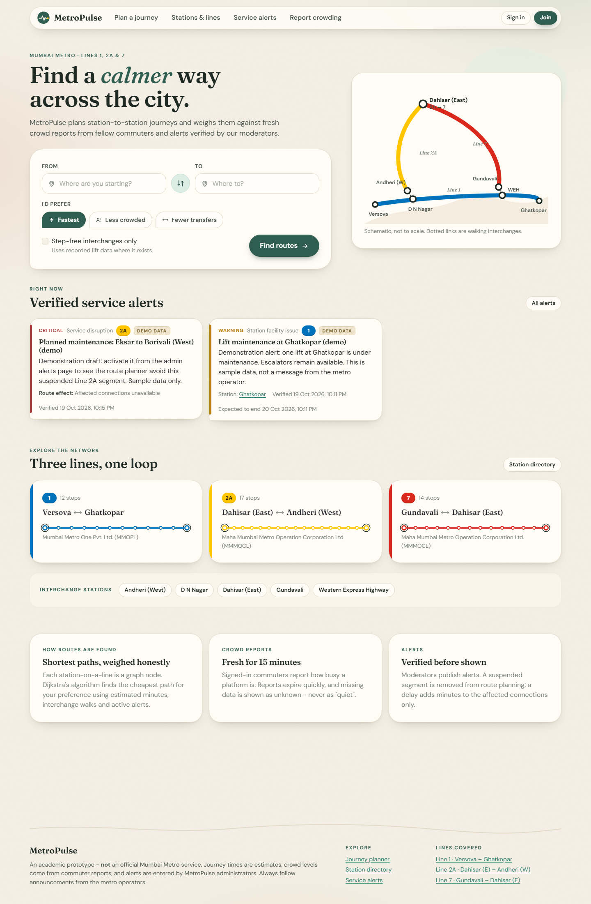
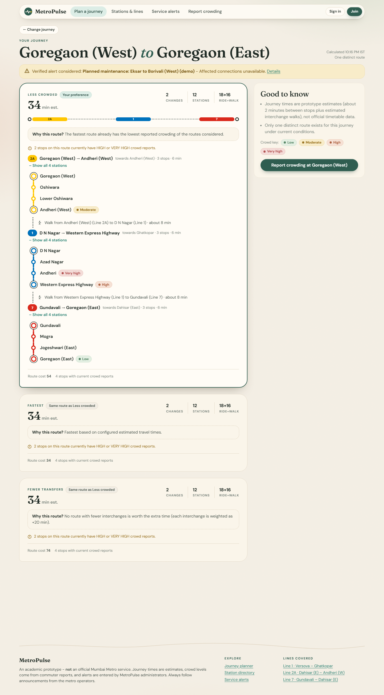
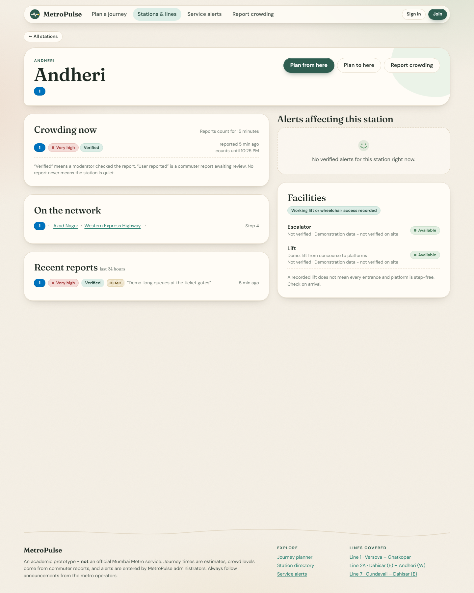
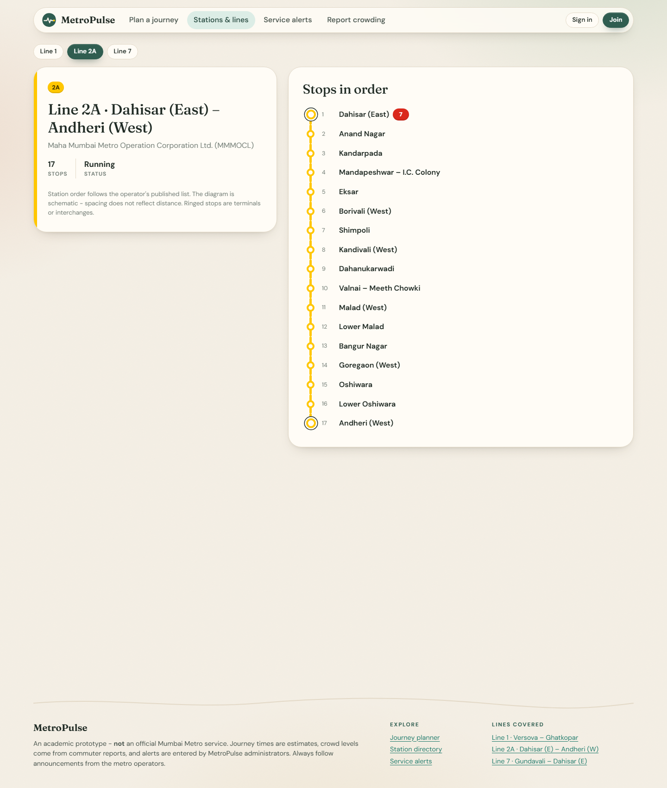
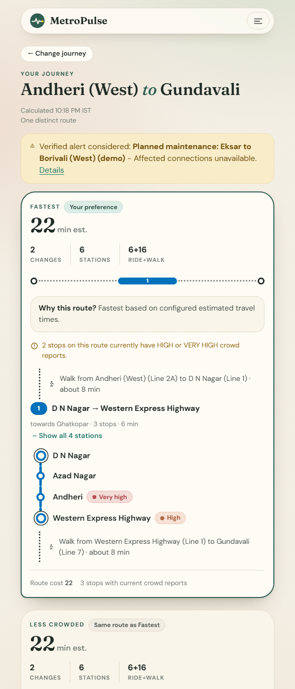

<div align="center">


# MetroPulse

### A crowd-aware smart journey planner for Mumbai Metro


<br/>


**Full Stack Java Programming · Academic mini-project**

| Team member | Roll No. |
|:---:|:---:|
| **Maithili Pawar** | D-248 |
| **Maitri Borkar** | D-215 |


</div>

MetroPulse plans station-to-station journeys on Mumbai Metro **Lines 1, 2A and 7** with Dijkstra's
shortest-path algorithm. It compares the fastest, less-crowded and fewer-transfer routes, and shows commuter
crowd reports and administrator-verified service alerts. It is built with **Java 21 and Spring Boot**.

> This is a student prototype, **not** an official Mumbai Metro service. Travel times are estimates, crowd levels
> come from user reports, and alerts are entered by MetroPulse administrators.

##  Quick start

Double-click **`run.cmd`**, or in a terminal:

```bash
cd E:\Maithili\MetroPulse
mvn spring-boot:test-run -Dspring-boot.run.main-class=com.metropulse.LocalDevApplication
```

> Maven commands must run inside the `MetroPulse` folder (where `pom.xml` is). Running them one folder up gives
> `No plugin found for prefix 'spring-boot'`.

Open **http://localhost:8080** and sign in as `admin@metropulse.local` / `CHANGE_ME_BEFORE_DEPLOYMENT`.
The database is included; full instructions are under [Running it](#running-it).

##  Screenshots

| Home and journey planner | Route results with explanations |
|:---:|:---:|
|  |  |
| **Station page** | **Line diagram** |
|  |  |

<div align="center">

<br/><sub>Responsive layout on a narrow screen</sub>
</div>


## Problem statement

Commuters can see where the metro goes, but not how busy it is right now or whether a disruption makes another
route better. MetroPulse models the network as a weighted graph and lets fresh crowd reports and verified alerts
change the route weights, while always telling the passenger how reliable that information is.

##  Key features

| Area | What it does |
|---|---|
| Journey planner | Searchable station pickers, swap button, three preferences, step-free option |
| Routing engine | Dijkstra on a directed graph of line-specific nodes; ride and transfer edges; up to three distinct routes, duplicates flagged; plain-language explanations |
| Crowd reports | Signed-in users report LOW / MODERATE / HIGH / VERY_HIGH; reports expire after 15 minutes; anti-spam limits; moderation |
| Service alerts | DRAFT → ACTIVE → RESOLVED / CANCELLED workflow; segment, station or line-wide effects (information, delay, suspension) |
| Stations & lines | Directory with partial search, station pages (crowding, interchanges, facilities, alerts), line diagrams |
| Facilities | Lifts, escalators, wheelchair access, etc. with status and verification time; step-free routing uses them carefully |
| Admin dashboard | Live statistics and Chart.js charts from the database, moderation queue, network integrity check, audit log |
| Security | Spring Security, BCrypt, COMMUTER / ADMIN roles, CSRF on forms, stateless HTTP Basic for the JSON API |

## Technology stack

Java 21 · Spring Boot 4.0.8 (Spring MVC, Spring Data JPA / Hibernate 7, Spring Security 7, Bean Validation) ·
Thymeleaf · Bootstrap 5.3 + custom CSS · vanilla JavaScript · Chart.js 4 · PostgreSQL · Flyway · Maven ·
JUnit 5 (Jupiter) · Mockito · Spring Boot Test · MockMvc.

Bootstrap, Chart.js and the two fonts (Fraunces, DM Sans) are stored in `src/main/resources/static/vendor`,
so the application needs no internet connection at runtime.

## Architecture overview

```
Browser ──► Thymeleaf pages (controller.web) ─┐
Program ──► JSON API      (controller.api) ─┤──► Services ──► Repositories (Spring Data JPA) ──► PostgreSQL
                                             │      │
                                             │      └──► service.routing: MetroGraphBuilder → DijkstraRouter
                                             │                              RouteCostModel, RouteDescriber, RouteExplainer
                                             └── Spring Security (two filter chains)
```

```
src/main/java/com/metropulse
├── config        .env loader, settings, production guard, demo seeding, date formatting
├── controller    web (pages) and api (JSON) controllers, error handlers
├── dto           response records and request forms
├── entity        JPA entities
├── enums         statuses, levels, categories
├── exception     business exceptions mapped to HTTP status codes
├── repository    Spring Data repositories
├── security      security config, login principal, admin bootstrap
├── service       business logic; service/routing holds the algorithm
└── validation    custom @DifferentStations constraint
```


---

## Running it

### Prerequisites

* **JDK 21** and **Maven 3.9+** (`java -version`, `mvn -v`)
* **A PostgreSQL server** (version 14 or newer). VS Code database extensions are only *clients*; they need a
  server to connect to. You only need one for the backup way below.

### Main way: one command, database included

```bash
mvn spring-boot:test-run -Dspring-boot.run.main-class=com.metropulse.LocalDevApplication
```

This starts a real PostgreSQL 17 server from Maven-downloaded binaries (nothing to install, no Docker), keeps its
data in `.localdb/` (git-ignored) and then starts MetroPulse. Open **http://localhost:8080**.
The first start takes a minute or two while Maven downloads everything; later starts take about 15 seconds.

* Stop it with **Ctrl+C** in the same terminal (this also stops the database cleanly).
* Data survives restarts. Delete the `.localdb/` folder for a completely fresh database.
* The database settings in `.env` are ignored in this mode; everything else (admin account, demo data, port) still applies.

### Backup: your own PostgreSQL server

Use this if the command above does not work, or when you want to see the tables in pgAdmin or a VS Code
database client. VS Code database extensions are only *clients*, so a PostgreSQL server must be installed.

1. Install PostgreSQL from postgresql.org. Set the `postgres` password (this project's `.env` expects `123456`)
   and keep port 5432.
2. Connect with your database client (127.0.0.1, 5432, user `postgres`, database `postgres`) and run once:

   ```sql
   CREATE DATABASE metropulse;
   ```

3. Check the connection details in the root `.env` file (same folder as `pom.xml`):

   ```dotenv
   DB_HOST=127.0.0.1
   DB_PORT=5432
   DB_NAME=metropulse
   DB_USERNAME=postgres
   DB_PASSWORD=123456
   ```

4. Start the application:

   ```bash
   mvn spring-boot:run
   ```

Flyway creates all tables and loads the network on first start. Open **http://localhost:8080**.

### From an IDE

Open the folder as a Maven project and run `com.metropulse.MetroPulseApplication` (backup way) or
`com.metropulse.LocalDevApplication` from `src/test/java` (main way). The working directory must be the project
folder so that `.env` is found.

### Signing in

The first start creates an administrator from `.env`:

| Setting | Development value |
|---|---|
| `ADMIN_EMAIL` | `admin@metropulse.local` |
| `ADMIN_PASSWORD` | `CHANGE_ME_BEFORE_DEPLOYMENT` |

The password is BCrypt-hashed before it is stored. An existing account is never overwritten, so changing
`ADMIN_PASSWORD` later does **not** change a live password. Commuters register themselves at `/register`.

---

## Environment configuration

Spring Boot does not read `.env` files by itself. `DotenvEnvironmentPostProcessor`
(registered in `META-INF/spring.factories`) reads the root `.env` at startup and adds it to the Spring
environment. Priority, highest first:

1. Real OS environment variables and `-D` JVM properties
2. The root `.env` file
3. Defaults written in `application.yml` (`${DB_HOST:127.0.0.1}` style)

Only the number of keys loaded is logged, never the values. `.env` is git-ignored; `.env.example` lists every
variable and is safe to commit.

| Variable | Purpose |
|---|---|
| `APP_ENV` | `development` or `production` |
| `APP_PORT` | HTTP port (default 8080) |
| `DB_HOST`, `DB_PORT`, `DB_NAME`, `DB_USERNAME`, `DB_PASSWORD` | PostgreSQL connection |
| `ADMIN_EMAIL`, `ADMIN_PASSWORD`, `ADMIN_DISPLAY_NAME` | First administrator account |
| `DEMO_DATA_ENABLED` | Seed labelled demonstration data (`true` / `false`) |
| `MAPS_API_KEY`, `MAIL_*` | Optional future integrations, unused and not needed |

**Other ways to supply settings:** in a terminal, `set DB_PASSWORD=...` (cmd) or `$env:DB_PASSWORD="..."`
(PowerShell) before `mvn spring-boot:run`; in IntelliJ / VS Code, add them as environment variables in the run
configuration. Both override `.env`.

**Before any deployment:** set `APP_ENV=production` and real values for `DB_PASSWORD` and `ADMIN_PASSWORD`.
In production the application **refuses to start** if a password is empty, starts with `CHANGE_ME`, or is
shorter than 12 characters (`ProductionSafetyCheck`). Demo-data reset is disabled in production.

## Demonstration data

With `DEMO_DATA_ENABLED=true`, the first start adds records marked `is_demo` and labelled "Demo":

* crowd reports at several levels, plus one expired and one rejected report
* an active verified alert (Ghatkopar lift), a resolved delay alert and a **draft** suspension of
  Eksar–Borivali (West). Activate it in *Admin → Alerts* to watch the planner route around it.
* facilities at several stations (source: "Demonstration data - not verified on site")

Demo crowd reports expire after 15 minutes like real ones. **Admin → Reset demo data** deletes only `is_demo`
rows and reseeds them; real reports, alerts and facilities are never touched. Try
**Goregaon (West) → Goregaon (East)** while the demo reports are fresh: the fastest route goes south via Line 1,
while the less-crowded and fewer-transfer options both go north via Dahisar (East).

The network itself (lines, stations, connections) is loaded by the Flyway migration
`V2__seed_network.sql`, separately from demo data (see [Data sources](#data-sources)).

##  Tests

```bash
mvn test
```

Integration tests run against a **real PostgreSQL** server started automatically from the zonky embedded binaries,
so they need neither Docker nor a local install. The first run downloads the binaries.
Result on 19 Oct 2026: `Tests run: 84, Failures: 0, Errors: 0`. To build the runnable jar: `mvn package`, then
`java -jar target/metropulse-1.0.0.jar` (run from the project folder so `.env` is found).

## Data sources

Station names and order were checked on 19 October 2026 against the operators' websites:

* MMMOCL (Lines 2A and 7): https://www.mmmocl.co.in/project_brief, https://www.mmmocl.co.in/network_under_operation
  and https://www.mmmocl.co.in/fare_table
* Mumbai Metro One (Line 1): https://www.reliancemumbaimetro.com/ticket-fares.aspx

Dahisar (East) is modelled on both Line 2A and Line 7, because the operator lists it at the end of Line 7.
D N Nagar ↔ Andheri (West) and Western Express Highway ↔ Gundavali are walking interchanges between separate stations.
Travel times (2 min per stop, 4–8 min per interchange) are estimates. Coordinates are not stored, and areas are approximate.

## Report

[docs/report-prompt.md](docs/report-prompt.md) is a ready-to-use prompt for writing the project report with diagrams.

## Troubleshooting

| Symptom | Fix |
|---|---|
| `Connection to 127.0.0.1:5432 refused` | No PostgreSQL server is running. Start it, or use the main one-command way |
| `password authentication failed for user "postgres"` | `DB_PASSWORD` in `.env` does not match your server |
| `database "metropulse" does not exist` | Run `CREATE DATABASE metropulse;` (or set `DB_NAME=postgres`) |
| `.env` values ignored | Start the app from the project folder; check the log line `Loaded N settings from ...\.env` |
| `Unsafe production configuration` at startup | Expected with placeholder passwords when `APP_ENV=production` |
| Port 8080 in use | Set `APP_PORT=8081` in `.env` |
| `No plugin found for prefix 'spring-boot'` | You are in the wrong folder: `cd` into `MetroPulse` (where `pom.xml` is), or use `run.cmd` |
| Admin login fails after changing `ADMIN_PASSWORD` | The account already existed; the old password still applies (by design) |

## Limitations

* Travel times are estimates (2 minutes between stops, 4–8 minutes per interchange), not timetables.
* Station coordinates are not stored, so there is no map; the diagrams are schematic.
* Crowd data depends entirely on user reports; with none, crowding is shown as unknown.
* Facility data is demonstration data until an administrator verifies it.
* Only Lines 1, 2A and 7 are modelled.

<div align="center">


<sub>Made by Maithili Pawar (D-248) and Maitri Borkar (D-215) · Full Stack Java Programming</sub>
</div>
