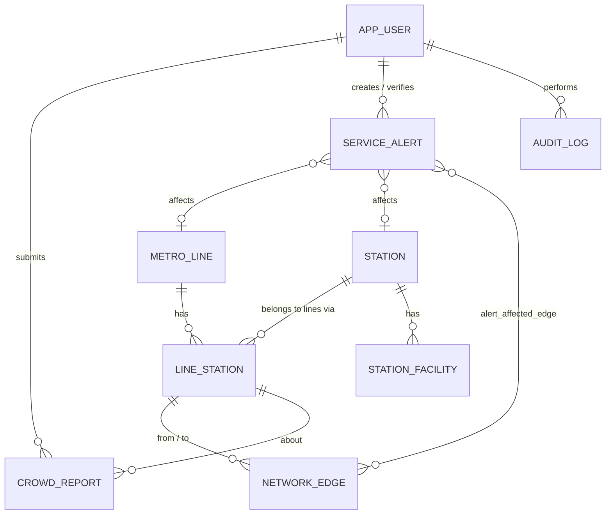

# Database design

PostgreSQL schema created by Flyway (`V1__create_schema.sql`), network data loaded by `V2__seed_network.sql`.
Hibernate runs with `ddl-auto: validate`, so the entities must match the migrations exactly.
All timestamps are `TIMESTAMPTZ` (stored in UTC, shown in IST).

## ER diagram

```
 metro_line 1───* line_station *───1 station 1───* station_facility
                    │  ▲  ▲
        from_node_id│  │  │to_node_id
                    ▼  │  │
                 network_edge *───* service_alert   (via alert_affected_edge)
                                       │   │
                    line_station 1───* crowd_report        service_alert *───0..1 metro_line
                                       │   │                service_alert *───0..1 station
                app_user 1───* crowd_report (user_id, verified_by)
                app_user 1───* service_alert (created_by, verified_by)
                app_user 1───* audit_log (actor_id)
```



## Tables

| Table | Purpose | Key columns and constraints |
|---|---|---|
| `metro_line` | A metro line | `line_code` unique; `color`/`text_color` must be `#RRGGBB`; `status` in OPERATIONAL/PARTIAL/SUSPENDED |
| `station` | A physical station | `code` unique (`A-Z0-9_`); `name` unique; latitude/longitude range checks (nullable, unverified) |
| `line_station` | Station on a line = graph node | unique (`line_id`, `station_id`); unique (`line_id`, `sequence_no`); `sequence_no > 0`; `is_operational` |
| `network_edge` | Directed connection | FKs to `line_station`; `edge_type` RIDE/TRANSFER; `base_minutes >= 0`; no self-loops; unique (`from`, `to`, `type`) |
| `app_user` | Accounts | unique index on `lower(email)`; `role` COMMUTER/ADMIN; BCrypt `password_hash` |
| `crowd_report` | Crowd observation | `crowd_level`; `verification_status`; `expires_at > created_at`; `user_id` required unless `is_demo` |
| `service_alert` | Alert | must target a line or a station; `ends_at > starts_at`; creator required unless demo; `impact`, `delay_minutes` 0–180 |
| `alert_affected_edge` | Alert ↔ edges | composite PK; cascades when an alert is deleted |
| `station_facility` | Facility | `facility_type`, `status` AVAILABLE/OUT_OF_SERVICE/UNKNOWN, `last_verified_at`, `source` |
| `audit_log` | Admin actions | actor, action, entity, details (no secrets) |

Extra columns beyond the original brief: `station.code` (stable identifier for seeding), `metro_line.text_color`
and `operator_name`, `network_edge.note`, `service_alert.impact`/`delay_minutes`/`verified_at`, and `is_demo` on
crowd reports, alerts and facilities so demo rows can be reset safely.

## Indexes

| Index | Used by |
|---|---|
| `idx_crowd_report_node_expiry (line_station_id, expires_at)` | current crowd levels |
| `idx_crowd_report_status_created (verification_status, created_at DESC)` | moderation queue |
| `idx_crowd_report_user_created (user_id, created_at DESC)` | rate limits, "my reports" |
| `idx_service_alert_status (status, starts_at)` | active alerts |
| `idx_line_station_station`, `idx_edge_to_node`, `idx_station_facility_station` | joins by station / node |
| `idx_audit_log_created` | audit log page |

## Integrity rules enforced in Java as well

* The graph builder skips edges that are not consecutive on one line, cross lines as rides, or stay on one line as
  transfers.
* Alerts: a station given together with a line must be on that line; segment ends must both be on the line.
* Adding a stop to a line creates the node and both ride edges in one transaction.
